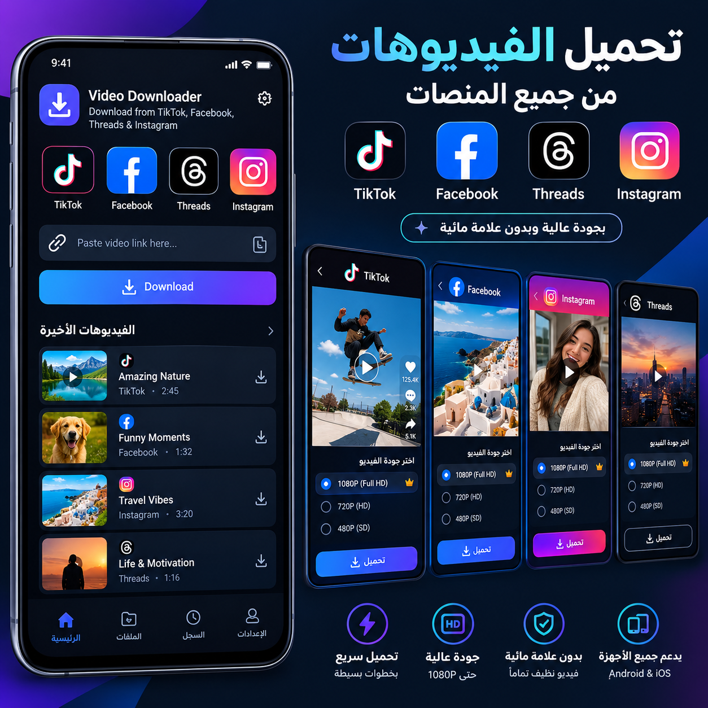

# FlowDrop — تطبيق تحميل الفيديوهات (Flutter)

نسخة Flutter/Dart كاملة من تطبيق FlowDrop الأصلي (Java/Android)، جاهزة للرفع على GitHub
وللتشغيل والبناء من **Klencod IDE**.



## المزايا

- لصق رابط (أو **مشاركته** إلى التطبيق من أي تطبيق آخر) واختيار **فيديو MP4 أو صوت MP3**.
- اختيار الجودة: 360p / 480p / 720p / 1080p / 1440p / 2160p / MAX، وجودة الصوت 128 / 192 / 256 / 320 kbps.
- تحميل **الروابط المباشرة** لملفات الوسائط (mp4, webm, mp3, m4a ...) بدون أي محرك.
- تحميل الروابط الأخرى عبر **محرك Cobalt** الذي تضبط رابطه ومفتاحه من الإعدادات، مع دعم شاشة اختيار العناصر (picker).
- مدير تحميلات: تقدّم حيّ، **إيقاف مؤقت / استئناف** (HTTP Range)، إلغاء، إعادة المحاولة، حتى 3 تحميلات معًا.
- تبويبات: الرئيسية، الملفات، السجل، الإعدادات.
- مشغّل مدمج للفيديو والصوت (تقديم/تأخير 10 ثوانٍ).
- نسخ تلقائي للملفات المكتملة إلى `Downloads/FlowDrop` (اختياري).
- عربي/إنجليزي مع RTL، ووضع فاتح/داكن/تلقائي بنفس ألوان التطبيق الأصلي.
- فحص التحديث (اختياري/إجباري) من Firebase Realtime Database عبر REST — راجع `FIREBASE_UPDATE_SETUP_AR.md`.

## هيكل المشروع

```
lib/
  main.dart                  نقطة البداية والثيم
  core/                      theme / l10n / utils / app_scope
  models/download_item.dart  نماذج التحميل والسجل
  services/
    download_manager.dart    محرك التحميل (stream + resume)
    cobalt_service.dart      عميل Cobalt API
    update_service.dart      فحص التحديث (Firebase REST)
    history_store.dart       السجل
    settings_store.dart      الإعدادات
    native_bridge.dart       جسر Kotlin (Downloads + استقبال المشاركة)
  screens/                   splash / shell / home / files / history / settings / player
  widgets/                   عناصر مشتركة + النوافذ السفلية
android/                     إعدادات Android + MainActivity.kt
.github/workflows/build-apk.yml   بناء APK تلقائي على GitHub
```

## التشغيل في Klencod IDE

1. افتح مجلد المشروع في Klencod IDE كمشروع Flutter.
2. نفّذ `flutter pub get`.
3. شغّل التطبيق على جهاز أو محاكي.

> إذا طلب IDE ملفات منصة Android ناقصة نفّذ مرة واحدة:
> `flutter create --platforms=android --org com.smali --project-name flowdrop .`
> (لن يستبدل ملفاتك الموجودة)، ثم احذف `android/settings.gradle.kts` و`android/build.gradle.kts`
> و`android/app/build.gradle.kts` إن ظهرت، فالمشروع يستخدم ملفات `.gradle`.

## البناء على GitHub

1. ارفع المشروع إلى مستودع GitHub (فرع `main`).
2. ادخل **Actions ← Build Android APK**، وسيعمل تلقائيًا عند كل push أو يدويًا من Run workflow.
3. حمّل الملف من **Artifacts ← flowdrop-release-apk**.

## ضبط محرك التحميل (مهم)

التحميل من المنصات (غير الروابط المباشرة) يحتاج **محرك Cobalt**:

1. شغّل نسخة Cobalt خاصة بك، أو استخدم محركًا لديك صلاحية استخدامه.
2. في التطبيق: **الإعدادات ← محرك Cobalt API** وأدخل رابط المحرك ومفتاح API (إن كان محميًا).
3. الرابط الافتراضي `https://api.cobalt.tools/` يطلب غالبًا مفتاح مصادقة، فبدونه ستظهر رسالة "مفتاح API غير صالح".

المنصات المدعومة تعتمد على المحرك الذي تضبطه وليس على التطبيق.

## تحديث التطبيق عبر Firebase

أنشئ العقدة `app_update` في Realtime Database (راجع `FIREBASE_UPDATE_SETUP_AR.md`). رابط القاعدة في
`lib/services/update_service.dart` (الثابت `configUrl`). إذا تعذر الاتصال يعمل التطبيق بشكل طبيعي.

## الفرق عن النسخة الأصلية

- **لم تُنقل** المستخرجات المدمجة لكل منصة (TikTok/Facebook/YouTube/Instagram... عبر خدمات طرف ثالث غير رسمية)؛
  استُبدلت بمحرك Cobalt الذي تضبطه أنت، لأن تلك المستخرجات تتعطل كلما تغيّرت الخدمات.
- لا توجد إشعارات تقدّم التحميل ولا اختيار مجلد حفظ مخصص (SAF) ولا صور مصغرة للفيديو في هذه النسخة.
- على Android 9 وما دونه يُطلب إذن التخزين عند أول نسخ إلى Downloads (يفشل النسخ في المرة الأولى ويعمل بعد منح الإذن).

## تنبيه قانوني

حمّل فقط المحتوى الذي تملكه أو لديك إذن بتنزيله، والتزم بشروط استخدام كل منصة وبقوانين حقوق النشر في بلدك.

## ملاحظة

لم يُجرَّب البناء داخل هذه البيئة (لا يوجد Flutter SDK)؛ الكود روجع يدويًا. عند ظهور أي خطأ في البناء أرسله لتصحيحه.


## إصلاح رفع الأصول عبر Klencod IDE

تم تغيير اسم إطار الحركة `frame_04.png` إلى `frame_04_alt.png` وتحديث مرجع Flutter إليه، كحل التفافي إذا كان خطأ GitHub HTTP 400 مرتبطًا بمسار الملف نفسه. الملف الأصلي كان PNG صالحًا بحجم 320×320، لذلك هذا التغيير ليس دليلًا على تلف الصورة. إذا استمر خطأ HTTP 400، فالمشكلة غالبًا في آلية الرفع/طلب GitHub في IDE أو في حالة المستودع، لا في بناء Flutter.
